# Adversarial Image Cloaking for Protection Against Face-Swap Attacks

**Jacob Antony Jeejo, Manasa Manoj, Praneetha Reddy** (equal contribution)

Indian Institute of Information Technology Kottayam

Course project, Multimedia Forensics

Code: https://github.com/J4KE-B/face-cloak · Live demo: https://face-cloak.vercel.app

---

## Abstract

One-shot face-swap tools need only a single photograph of a person to place that person's face into another image or video. We study a proactive defence: before a photograph is published, a small, L∞-bounded adversarial perturbation (a "cloak") is added so that swaps built from it no longer carry the person's identity. The key observation is that the widely deployed inswapper_128 model receives the source identity only through the embedding of one ArcFace recogniser (w600k_r50); attacking that encoder with projected gradient descent (PGD) is therefore a white-box attack on the swapper's identity channel, while SimSwap, which uses its own ArcFace network, serves as a black-box transfer test. We cloak 150 Labeled Faces in the Wild (LFW) identities, swap each onto three targets, and judge every swap with a held-out recogniser (glintr100) against a second, uncloaked photo of the same person, at a threshold calibrated to a 1 % false-accept rate. At ε = 8/255, an ensemble attack (ArcFace w600k_r50 + FaceNet) with Expectation over Transformation (EOT) and an LPIPS penalty raises the protection success rate (PSR) from 1.3 % (no cloak) to 99.3 % on inswapper and 85.1 % on SimSwap, at LPIPS 0.020 and PSNR 33.61 dB. With EOT the cloak survives JPEG quality 50 (98.7 % inswapper, 81.6 % SimSwap), whereas plain single-model PGD falls to 50.2 % on inswapper under the same compression. Strong Gaussian blur (σ = 2) and bilateral filtering remain the main weaknesses (for the EOT + LPIPS cloak: 71.8 % and 87.3 % on inswapper, 48.7 % and 46.4 % on SimSwap). We report all results with cluster-bootstrap confidence intervals over source identities and discuss the gap between a recogniser's verdict and human perception of a swap.

**Index Terms**: adversarial examples, deepfakes, face swapping, face recognition, privacy protection, proactive defence, multimedia forensics.

---

## 1. Introduction

Face manipulation has moved from research code to consumer tools [1]. Identity-swapping methods such as FaceShifter [2] and SimSwap [3], and open-source front ends built on the InsightFace [4] inswapper_128 model (roop, FaceFusion, Deep-Live-Cam), need only one photograph of the victim. A single profile picture is therefore often enough raw material for a convincing deepfake. Forensic detection works after the fact, once a fake is already circulating. This project studies the complementary, *proactive* approach: modify the photograph before it is shared so that it is useless as a face-swap source.

The core idea follows from how these swappers are built. A one-shot swapper does not copy pixels from the source photo; it first compresses the source face into an *identity embedding* produced by a face-recognition network, and a generator then paints that identity onto the target face. For inswapper_128, the identity input is the L2-normalised embedding of the ArcFace [5] model w600k_r50 (from the InsightFace buffalo_l package), multiplied by a fixed matrix (`emap`) stored with the swapper. The swapper sees the source identity *only* through this embedding. If we perturb the photo so that w600k_r50 maps it far from the person's true embedding, the swapper receives a wrong identity, and the swap produced from the cloaked photo no longer matches the person. Because w600k_r50 is public, this is a white-box attack on the swapper's identity channel, even though we never differentiate through the swapper's generator. SimSwap uses its own ArcFace checkpoint, which we never attack, so it measures black-box transfer.

**Contributions.**

1. An identity-feature cloak against one-shot face swapping, built on L∞ PGD [6] with differentiable face alignment, an ensemble of two recognisers (ArcFace w600k_r50, converted from ONNX to PyTorch, and FaceNet), optional decoy targeting, EOT [7], an LPIPS [8] perceptual term and a detector-suppression term. To our knowledge, protecting the identity-donor (source) photo against one-shot, embedding-based swappers in this way has received less attention than protecting the edited image.
2. A controlled evaluation on 150 LFW [9] identities × 3 targets × 2 swappers × 10 post-processing transforms (86,400 swap rows including ablations), judged by a *held-out* recogniser against a separate reference photo, with a threshold calibrated on LFW at a 1 % false-accept rate and cluster-bootstrap confidence intervals.
3. An analysis of what works (EOT is the most important ingredient for both robustness and black-box transfer; the LPIPS term reduces perceptual distortion without reducing PSR) and what does not (decoy targeting, the detector term, and more PGD steps for transfer).
4. A public live demo (Next.js front end, FastAPI back end on a Kaggle GPU) with privacy safeguards, and a reproducible pipeline pinned to a single commit.

---

## 2. Related Work

### 2.1 Face swapping

Deepfake generation and detection are surveyed by Tolosana *et al.* [1]; FaceForensics++ [10] established a widely used benchmark for detecting manipulated facial images. Identity-swapping networks such as FaceShifter [2] and SimSwap [3] extract an identity representation from the source face with a pretrained recogniser and inject it into a generator that preserves the target's attributes. The recognisers involved are ArcFace-style networks [5] of the kind distributed in the InsightFace model zoo [4]; training such recognisers on very large identity sets is addressed by methods such as Partial FC [11]. Faces are located with a detector such as SCRFD [12], which also provides five landmarks for alignment.

### 2.2 Proactive defences against manipulation

Adversarial examples [13], [14] can be used defensively. Ruiz *et al.* [15] disrupt conditional image-translation and facial-manipulation networks by perturbing the input image so that the manipulated output is corrupted. TAFIM [16] computes targeted adversarial perturbations against facial image manipulations, CMUA-Watermark [17] seeks a single cross-model universal perturbation against several deepfake models, and Anti-Forgery [18] uses perceptual-aware perturbations for a stealthier and more robust disruption. PhotoGuard [19] and Anti-DreamBooth [20] extend the idea to diffusion-based editing and personalised text-to-image synthesis. To our knowledge, these methods mainly target the *edited-image path*: they protect the image that the manipulation model modifies (in face-swap terms, the target frame) and aim to corrupt the output. Our setting is different: we protect the *source* photo that donates the identity, and the objective is that the swap no longer carries the person's identity, not that it looks broken.

### 2.3 Anti-face-recognition cloaking

Our method is closest to cloaking against face recognition. Fawkes [21] perturbs a user's photos in the feature space of a recogniser, pushing them towards a dissimilar decoy identity, to protect against unauthorised recognition models. LowKey [22] uses adversarial attacks on face-recognition models to protect social-media users from facial-recognition search. We reuse ingredients from this line of work (a feature-space objective, a model ensemble, decoy targeting, a perceptual penalty) but apply them to a different threat, face swapping, in which the recogniser is a *component* of the attacker's generator rather than the attacker's end goal.

### 2.4 Purification and adaptive attacks

A defence based on adversarial perturbations is only as strong as the attacker it is evaluated against. Athalye *et al.* [23] showed that many defences give a false sense of security and are broken by adaptive attacks such as BPDA; EOT [7] makes perturbations robust to random transformations. Diffusion-based purification such as DiffPure [24] can remove adversarial perturbations before a model sees them. We evaluate against fixed, non-adaptive pre-processing only; purification and adaptive attackers are discussed as limitations (Section 8).

---

## 3. Threat Model

**Parties.** The defender is a person who wants to share a photo of their face. The attacker obtains the published photo and uses it as the *source* of a one-shot face swap onto a *target* image of their choosing. The attacker wants a swap that is recognised as the defender.

**Attacker capabilities.** The attacker runs an off-the-shelf swapper (inswapper_128 or SimSwap). The attacker re-detects the face in the downloaded photo, re-estimates its five landmarks and re-aligns it, so the defender cannot rely on a fixed crop. Before swapping, the attacker may apply common, non-adaptive image processing to the photo: JPEG re-compression, down- and up-scaling, Gaussian blur, median filtering or bilateral filtering (Section 5.5).

**Defender knowledge.** For inswapper_128 the defender knows the identity encoder exactly (w600k_r50 is public), so the defence is white-box on the identity channel; the defender does not differentiate through the swapper's generator. For SimSwap the defender has no access to its identity network, so protection must transfer (black-box).

**Success criterion.** A swap is *protected* if a held-out face recogniser, comparing the swap with a different, uncloaked photo of the same person, scores it below the threshold τ at which that recogniser accepts 1 % of impostor pairs.

**Out of scope.** The *target* path (protecting the image or video being edited); adaptive attackers who know the cloaking algorithm; learned purification (e.g., diffusion models); swappers that do not use a recogniser embedding; video; and human perceptual studies.

---

## 4. Method

### 4.1 Notation and identity objective

Let $x_0 \in [0,1]^{H \times W \times 3}$ be the clean photo and $k \in \mathbb{R}^{5 \times 2}$ the five SCRFD [12] landmarks detected on it. For each attack recogniser $m$, $A_m(x, k)$ denotes the aligned face crop and $E_m(\cdot)$ the L2-normalised embedding. The clean reference embedding is $e_m = E_m(A_m(x_0, k))$. We seek a perturbation $\delta$ with $\lVert \delta \rVert_\infty \le \epsilon$ that minimises

$$
\mathcal{L}(x_0 + \delta) = \sum_{m} w_m \left\langle E_m\big(A_m(x_0+\delta, k)\big), e_m \right\rangle + \lambda_{p} \, \mathrm{LPIPS}(x_0+\delta, x_0) + \lambda_{d} \, D(x_0+\delta)
$$

where $\langle\cdot,\cdot\rangle$ is the cosine similarity of unit vectors, $w_m$ are model weights, $\mathrm{LPIPS}$ is the learned perceptual distance [8] and $D$ is a detector-confidence term (Section 4.7). Minimising the first term drives the cloaked photo's embedding away from the person's own embedding; a negative cosine means it points in the opposite direction. $\lambda_p$ and $\lambda_d$ are zero except in the variants that use these terms.

**Targeted decoy variant.** Following Fawkes [21], a "both" mode additionally pulls the embedding towards a decoy identity embedding $d_m$:

$$
\mathcal{L}_{\text{both}} = \sum_m w_m \Big( \left\langle E_m(\cdot), e_m \right\rangle - \lambda_{t} \left\langle E_m(\cdot), d_m \right\rangle \Big) + \dots
$$

The decoy is chosen from the pool of 30 target identities, using w600k_r50 only (never a judge): it is the pool face whose embedding is least similar (minimum cosine) to the source's clean embedding, excluding the targets paired with that source and any target of the same identity, so the decoy never coincides with a face the source will be swapped onto. The other attack model (FaceNet) only embeds the chosen decoy. We use $\lambda_t = 1$.

### 4.2 Projected gradient descent

We use L∞ PGD [6] with sign gradients, as in FGSM [14]:

$$
\delta_{t+1} = \Pi_{\epsilon}\Big(\delta_t - \alpha \, \mathrm{sign}\big(\nabla_{\delta} \mathcal{L}(x_0 + \delta_t)\big)\Big)
$$

where $\Pi_\epsilon$ clips $\delta$ to $[-\epsilon, \epsilon]$ and then clips $x_0 + \delta$ to the valid range $[0,1]$. Hyperparameters of the main experiment: $\epsilon = 8/255$; step size $\alpha = \epsilon/10 = 0.8/255$; 100 steps; uniform random start in $[-\epsilon, \epsilon]$; random seed 0. The perturbation may cover the whole image (no face mask).

### 4.3 Differentiable alignment

The recogniser does not see the full photo; it sees an aligned crop. To obtain gradients with respect to the full-resolution pixels, alignment is implemented differentiably. From the five landmarks we estimate a similarity transform (Umeyama) onto the standard ArcFace five-point template and warp the image with PyTorch `affine_grid`/`grid_sample` (bilinear) to 112 × 112 for ArcFace, or to 160 × 160 (template scaled by 160/112) for FaceNet. The gradient therefore flows back through the warp to every input pixel that influences the crop.

### 4.4 Attack models and ONNX-to-PyTorch conversion

The InsightFace w600k_r50 recogniser is distributed as an ONNX graph, which cannot be differentiated in PyTorch directly. We convert it with `onnx2torch` and verify parity: in the parity test the converted and original models give embeddings with cosine similarity above 0.9999 (1.0 to the reported precision). The second ensemble member is FaceNet [25] (InceptionResnetV1 trained on VGGFace2 [26]). The ensemble weights are 1.0 for both models. The evaluation-only recognisers glintr100 and w600k_mbf are explicitly refused by the cloaking code, so the held-out judge cannot leak into the attack.

### 4.5 Expectation over Transformation

The attacker may re-compress, resize or blur the photo, and re-detects the landmarks, which introduces small alignment errors. We therefore optimise the loss in expectation over a distribution of transformations [7]. At every PGD step one random transformation is sampled: resize, blur and JPEG are each applied independently with probability 0.5 (so between none and all three, always in that order), and the landmark rotation and translation jitter are always applied. The transformed image and jittered landmarks are then passed to the alignment.

| Component | Probability | Parameter range |
|---|---|---|
| Resize down and back up (bilinear, anti-aliased) | 0.5 | scale uniform in [0.5, 1.0] |
| Gaussian blur | 0.5 | σ uniform in [0.5, 1.5] |
| JPEG round-trip (straight-through gradient estimator) | 0.5 | quality integer in [50, 95] |
| Landmark rotation jitter about the landmark centroid | always | angle uniform in [−3°, 3°] |
| Landmark translation jitter | always | Gaussian noise, 2 px |

The JPEG round-trip is a real codec call in the forward pass; in the backward pass its gradient is taken as the identity (straight-through estimator). The LPIPS and detector terms are computed on the untransformed image.

### 4.6 Best-iterate selection

With one EOT sample per step the PGD loss is noisy, so the last iterate is not necessarily the best. Every 10 steps (and at the final step) the current perturbation is scored by its mean loss over 8 fixed, seeded EOT samples. The same 8 samples are used for every candidate, so candidates are compared on equal footing and on the transformed images the cloak is meant to survive. Without EOT the clean loss is used. The perturbation with the lowest score (including the random start) is returned.

### 4.7 Perceptual and detector terms

**LPIPS term.** With $\lambda_p = 1$, the LPIPS distance between the cloaked and clean images is added to the loss. This encourages perturbations that are less visible to a learned perceptual metric without changing the L∞ budget.

**Detector term.** With $\lambda_d = 1$, $D$ is the mean of the top-50 face-confidence scores over all strides of a differentiable PyTorch implementation of the SCRFD detector. The aim was to make the attacker's face detector miss the face altogether.

### 4.8 Quantisation

The cloaked image is rounded to 8-bit integers and saved as PNG before any evaluation. The budget $\epsilon$ is required to be an integer number of 8-bit levels, so rounding cannot exceed it, and the code asserts $\lVert \tilde{x} - x_0 \rVert_\infty \le \epsilon$ for every delivered image $\tilde{x}$. All metrics are computed on this delivered uint8 image, not on the floating-point optimisation variable.

---

## 5. Experimental Setup

### 5.1 Data

We use LFW [9] (figshare mirror, checksum-verified). A fixed manifest defines 150 source identities and 30 target identities. Each source has a photo A (the one that is cloaked) and a photo B of the same person (a held-out reference that is never cloaked). Each source is swapped onto 3 targets, giving 450 swaps per attack, per transform and per swapper.

### 5.2 Swappers

- **inswapper_128**, the model used by roop, FaceFusion and Deep-Live-Cam. Its source latent is the normalised w600k_r50 embedding multiplied by `emap`. Because w600k_r50 is our attack model, this is the **white-box** case for the identity encoder; the swapper's generator remains a black box (the code calls this setting grey-box).
- **SimSwap** [3] (commit bd7b768), which uses its own ArcFace checkpoint for the identity latent. This is the **black-box** transfer case. Our SimSwap pipeline uses the buffalo_l SCRFD landmarks (the same detector as the cloak and inswapper, because SimSwap's own detector is not shipped with its checkpoints) and a re-implemented paste-back with a feathered mask instead of the optional BiSeNet face-parsing mask. SimSwap's identity encoder is a different ArcFace-family network, so the black-box result measures transfer across ArcFace-family encoders, not to arbitrary recognisers.

### 5.3 Judges and threshold calibration

Each swap is scored by three recognisers:

- **glintr100** (InsightFace antelopev2): the **primary, held-out judge**. It is never used in the attack, so it measures whether identity was removed rather than whether the attack model was fooled.
- **w600k_mbf**: a secondary judge. It shares training data with the attack model, so it is not fully independent.
- **w600k_r50**: the attack model itself, reported only as a labelled **white-box judge**.

The threshold τ of each judge is calibrated on LFW verification pairs. Pairs involving manifest identities are excluded (458), leaving 2,702 genuine and 2,811 impostor pairs (29 skipped).

| Judge | τ at FAR 1 % | τ at FAR 0.1 % | EER | TAR at FAR 1 % | 10-fold accuracy | Role |
|---|---|---|---|---|---|---|
| glintr100 | 0.1564 | 0.2539 | 0.25 % | 99.74 % | 99.84 % (sd 0.16) | held-out, primary |
| w600k_mbf | 0.1658 | 0.2664 | 0.40 % | 99.63 % | 99.64 % (sd 0.23) | secondary |
| w600k_r50 | 0.1418 | 0.2258 | 0.25 % | 99.78 % | 99.86 % (sd 0.17) | white-box judge |

All three judges are near-perfect verifiers on clean LFW pairs. Calibration accuracy is measured on unswapped photos, however; the more relevant check is the clean-swap baseline: without a cloak only 1.3 % of swaps fall below τ (Section 6.1), so a cloaked swap that falls below τ is unlikely to be explained by judge error on swapped images. All reported PSR values use τ at FAR 1 %.

### 5.4 Metric

For a cloaked source photo $\tilde{A}$, target $T$ and judge $J$:

$$
\text{id-sim} = \cos\Big(J\big(\mathrm{swap}(\tilde{A} \rightarrow T)\big), J(B)\Big), \qquad \mathrm{PSR} = \frac{\big|\lbrace \text{valid swaps with id-sim} < \tau_J\rbrace\big|}{\big|\lbrace \text{valid swaps}\rbrace\big|}
$$

Comparing with photo B rather than photo A avoids rewarding a swap that merely reproduces the content of the cloaked photo. Swaps in which no face is found are counted separately as detection failures, and a variant of PSR counts them as protected; in all experiments reported here the detection-failure rate was 0.0, so both variants coincide. Image quality is measured between the clean and cloaked source photos with PSNR, SSIM and LPIPS.

**Confidence intervals.** All 95 % confidence intervals are percentile cluster-bootstrap intervals that resample *source identities* (the three swaps of one source are correlated). When the bootstrap interval is degenerate (width zero, e.g., a PSR of exactly 100 %), it is replaced by a Wilson score interval over the valid rows; this treats rows as independent and is therefore optimistic. Such entries are marked with an asterisk.

### 5.5 Post-processing transforms

To test robustness, a transform is applied to the cloaked PNG *before* the attacker uses it: none; JPEG quality 90, 75 or 50; resizing to 0.75 or 0.5 of the size and back; Gaussian blur with σ = 1 or 2; a 3 × 3 median filter; a bilateral filter.

### 5.6 Attacks compared

| Name | Description |
|---|---|
| clean | no cloak |
| noise | random ±8/255 sign noise at the same L∞ budget |
| pgd_r50 | PGD against w600k_r50 only |
| pgd_ens | PGD against w600k_r50 + FaceNet |
| pgd_ens_targeted | pgd_ens + decoy term |
| pgd_ens_eot | pgd_ens + EOT |
| pgd_ens_eot_lpips | pgd_ens + EOT + LPIPS term |
| pgd_ens_det | pgd_ens + detector term |

All PGD attacks use ε = 8/255 and 100 steps. Two ablations vary the budget of pgd_ens (ε ∈ {2, 4, 8, 12, 16}/255) and its number of steps (20, 50, 100); each is evaluated without post-processing and with JPEG 75.

### 5.7 Compute

All experiments ran on the Kaggle free tier on an NVIDIA Tesla T4, split into two sessions that each handled half of the source identities (shards 0/2 and 1/2) and took about 7.05 h each. Both sessions ran code pinned to commit e32b9b6 with a clean working tree (PyTorch 2.11.0+cu128, insightface 0.7.3, onnx2torch 1.5.15, lpips 0.1.4, Python 3.13.15). Full judge calibration takes about 25 min on the GPU. In total the experiments produced 86,400 swap rows: 72,000 for the main experiment (8 attacks × 450 swaps × 10 transforms × 2 swappers), 9,000 for the ε ablation and 5,400 for the steps ablation.

---

## 6. Results

Unless stated otherwise, PSR is measured with the held-out judge glintr100, with n = 450 swaps per row, all swaps valid, and 95 % cluster-bootstrap confidence intervals in brackets.

### 6.1 Main results

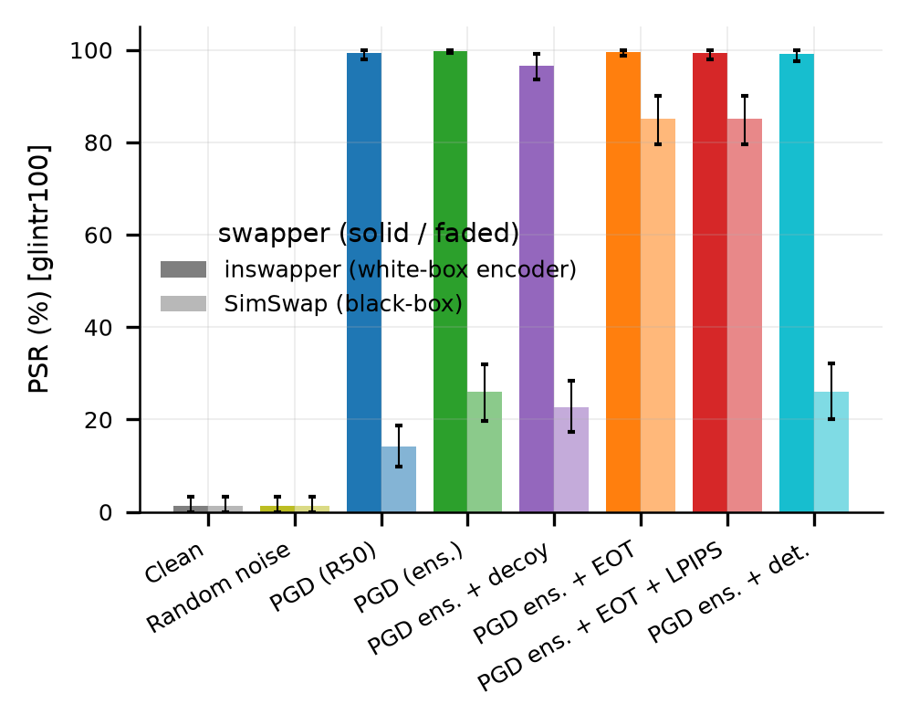

*Figure 1. PSR per attack for inswapper (white-box encoder, solid bars) and SimSwap (black-box, faded bars), with 95 % confidence intervals.*

**Table 1. Main results, no post-processing.** Quality metrics compare the cloaked and clean source photos and are the same for both swappers. Cloak time is the mean wall time per image on a Kaggle T4.

| Attack | inswapper PSR % (white-box encoder) | inswapper mean id-sim | SimSwap PSR % (black-box) | SimSwap mean id-sim | PSNR (dB) | SSIM | LPIPS | Cloak time (s) |
|---|---|---|---|---|---|---|---|---|
| clean | 1.3 [0.0, 3.3] | +0.631 | 1.3 [0.0, 3.3] | +0.460 | n/a | 1.0 | 0.0 | 0.0 |
| noise | 1.3 [0.0, 3.3] | +0.618 | 1.3 [0.0, 3.3] | +0.451 | 30.25 | 0.716 | 0.191 | 0.002 |
| pgd_r50 | 99.3 [98.0, 100.0] | −0.310 | 14.2 [9.8, 18.7] | +0.271 | 33.94 | 0.854 | 0.102 | 1.616 |
| pgd_ens | 99.8 [99.3, 100.0] | −0.176 | 26.0 [19.8, 32.0] | +0.237 | 33.74 | 0.850 | 0.107 | 5.176 |
| pgd_ens_targeted | 96.7 [93.6, 99.1] | −0.069 | 22.7 [17.3, 28.4] | +0.246 | 33.76 | 0.851 | 0.105 | 5.245 |
| pgd_ens_eot | 99.6 [98.7, 100.0] | −0.190 | **85.1** [79.6, 90.0] | +0.042 | 33.59 | 0.855 | 0.094 | 7.496 |
| pgd_ens_eot_lpips | 99.3 [98.0, 100.0] | −0.187 | **85.1** [79.6, 90.0] | +0.045 | 33.61 | 0.851 | **0.020** | 8.401 |
| pgd_ens_det | 99.1 [97.6, 100.0] | −0.160 | 26.0 [20.0, 32.2] | +0.234 | 33.20 | 0.830 | 0.170 | 7.306 |

Without a cloak, only 1.3 % of swaps fall below τ on either swapper: both swappers transfer identity reliably, with a mean similarity to the reference photo of +0.631 (inswapper) and +0.460 (SimSwap). Random sign noise at the same budget has no effect (1.3 %), which shows that protection comes from the optimised direction of the perturbation, not from its magnitude.

**White-box encoder (inswapper).** Every PGD variant protects at least 96.7 % of swaps. Attacking w600k_r50 alone already reaches 99.3 %, with a mean id-sim of −0.310: on average the swap is negatively correlated with the person's reference photo in the judge's embedding space.

**Black-box (SimSwap).** Transfer is weak without EOT: the single-model attack reaches 14.2 % and the two-model ensemble 26.0 %. Adding EOT raises PSR to 85.1 %, the largest single improvement in the study. The LPIPS term keeps this PSR (85.1 %) while reducing LPIPS from 0.094 to 0.020.

**Quality and cost.** All PGD cloaks lie between 33.20 and 33.94 dB PSNR at ε = 8/255, and the L∞ norm of every cloak is exactly 8/255. Random noise has a *lower* PSNR (30.25 dB) because it changes every pixel by the full budget. The recommended configuration, pgd_ens_eot_lpips, takes 8.4 s per image on a T4; the single-model attack takes 1.6 s.

### 6.2 Robustness to post-processing

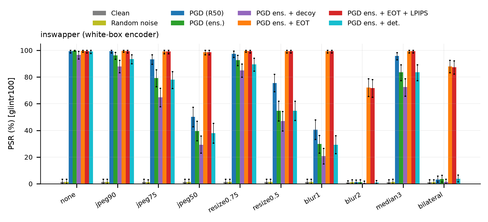

*Figure 2. Robustness on inswapper (white-box encoder): PSR per attack and post-processing transform.*

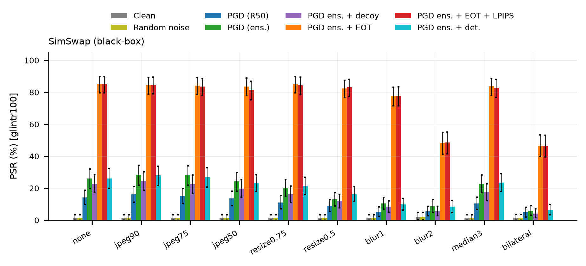

*Figure 3. Robustness on SimSwap (black-box): PSR per attack and post-processing transform.*

**Table 2. PSR (%) under post-processing applied to the cloaked photo before swapping** (point estimates; full tables with CIs in Appendix B).

| Attack | Swapper | none | JPEG 90 | JPEG 75 | JPEG 50 | resize 0.75 | resize 0.5 | blur σ=1 | blur σ=2 | median 3 | bilateral |
|---|---|---|---|---|---|---|---|---|---|---|---|
| pgd_r50 | inswapper | 99.3 | 99.3 | 93.3 | 50.2 | 97.3 | 75.6 | 40.4 | 1.1 | 95.8 | 3.1 |
| pgd_ens | inswapper | 99.8 | 96.2 | 79.3 | 39.6 | 92.7 | 54.7 | 29.8 | 1.1 | 83.6 | 3.6 |
| pgd_ens_eot | inswapper | 99.6 | 99.6 | 99.1 | 98.7 | 99.6 | 99.3 | 99.3 | 72.2 | 99.3 | 88.0 |
| pgd_ens_eot_lpips | inswapper | 99.3 | 99.3 | 99.1 | 98.7 | 99.3 | 99.3 | 99.3 | 71.8 | 99.3 | 87.3 |
| pgd_r50 | SimSwap | 14.2 | 16.2 | 15.1 | 13.6 | 11.1 | 8.9 | 5.1 | 5.6 | 10.4 | 4.9 |
| pgd_ens | SimSwap | 26.0 | 28.4 | 28.2 | 24.2 | 20.2 | 13.1 | 10.4 | 8.7 | 22.7 | 6.0 |
| pgd_ens_eot | SimSwap | 85.1 | 84.4 | 84.2 | 83.6 | 85.1 | 82.4 | 77.6 | 48.4 | 83.8 | 46.7 |
| pgd_ens_eot_lpips | SimSwap | 85.1 | 84.7 | 83.6 | 81.6 | 84.4 | 83.1 | 77.8 | 48.7 | 82.9 | 46.4 |

Without EOT the cloak is brittle. On inswapper, pgd_r50 drops from 99.3 % to 50.2 % under JPEG 50, to 40.4 % under blur σ = 1 and to 1.1 % (the clean level) under blur σ = 2; bilateral filtering removes it almost completely (3.1 %). The ensemble without EOT is even more fragile under compression (39.6 % at JPEG 50).

With EOT, inswapper PSR stays at or above 98.7 % for every JPEG quality, both resize factors, blur σ = 1 and the median filter. The remaining weaknesses are blur σ = 2 (72.2 % for pgd_ens_eot, 71.8 % for pgd_ens_eot_lpips) and bilateral filtering (88.0 % and 87.3 %), both outside the EOT training distribution (blur σ at most 1.5; no bilateral filter). On SimSwap, the EOT cloaks keep 81.6–85.1 % under JPEG and resizing and 77.6–77.8 % under blur σ = 1, but fall to 46.4–48.7 % under blur σ = 2 and bilateral filtering. The clean and noise rows (Appendix B) stay between 0.9 % and 2.2 % under every transform, so the transforms themselves do not create false protection. On SimSwap, mild JPEG slightly *raises* the PSR of the non-EOT cloaks (pgd_ens: 26.0 % → 28.4 % at JPEG 90), but these differences lie within the confidence intervals.

### 6.3 Secondary judges

**Table 3. PSR (%) by judge, no post-processing.** glintr100 is held out; w600k_mbf shares training data with the attack model; w600k_r50 *is* the attack model (white-box judge).

| Attack | inswapper: glintr100 | inswapper: w600k_mbf | inswapper: w600k_r50 (white-box) | SimSwap: glintr100 | SimSwap: w600k_mbf | SimSwap: w600k_r50 (white-box) |
|---|---|---|---|---|---|---|
| clean | 1.3 | 1.3 | 1.1 | 1.3 | 1.8 | 1.6 |
| noise | 1.3 | 1.3 | 1.1 | 1.3 | 2.2 | 1.6 |
| pgd_r50 | 99.3 | 99.1 | 99.3 | 14.2 | 17.3 | 15.6 |
| pgd_ens | 99.8 | 99.1 | 99.8 | 26.0 | 25.1 | 25.3 |
| pgd_ens_targeted | 96.7 | 95.3 | 97.3 | 22.7 | 22.9 | 22.0 |
| pgd_ens_eot | 99.6 | 99.3 | 99.8 | 85.1 | 85.1 | 87.1 |
| pgd_ens_eot_lpips | 99.3 | 99.3 | 99.3 | 85.1 | 85.3 | 86.7 |
| pgd_ens_det | 99.1 | 97.3 | 99.1 | 26.0 | 26.4 | 26.2 |

The three judges agree closely, so the conclusion "identity was removed" does not depend on a single recogniser. Agreement with w600k_mbf is weaker evidence than agreement with glintr100, because w600k_mbf was trained on the same data as the attack model. The white-box judge w600k_r50 is reported for completeness only; on inswapper it is equal to or higher than the held-out judge for every PGD attack, as expected for the model the cloak was optimised against.

### 6.4 Perturbation budget ε

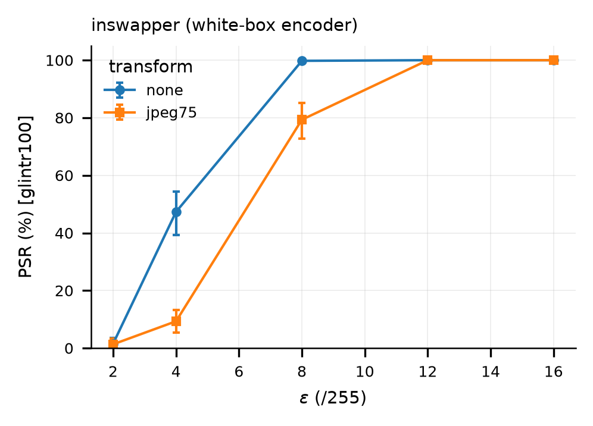

*Figure 4. Effect of the budget ε on PSR, inswapper (pgd_ens, no EOT).*

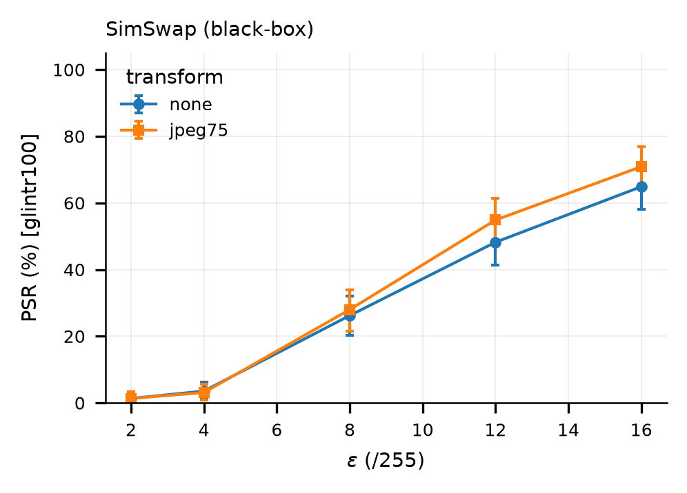

*Figure 5. Effect of the budget ε on PSR, SimSwap (pgd_ens, no EOT).*

**Table 4. ε ablation for pgd_ens (no EOT), PSR % [95 % CI].** \* = Wilson interval (degenerate bootstrap).

| ε (/255) | PSNR (dB) | LPIPS | Cosine to clean (w600k_r50) | inswapper, none | inswapper, JPEG 75 | SimSwap, none | SimSwap, JPEG 75 |
|---|---|---|---|---|---|---|---|
| 2 | 44.92 | 0.006 | +0.651 | 1.6 [0.0, 3.6] | 1.3 [0.0, 3.3] | 1.3 [0.0, 3.3] | 1.3 [0.0, 3.3] |
| 4 | 39.22 | 0.030 | +0.047 | 47.3 [39.3, 54.4] | 9.3 [5.3, 13.3] | 3.6 [1.3, 6.2] | 3.1 [0.9, 5.6] |
| 8 | 33.74 | 0.107 | −0.584 | 99.8 [99.3, 100.0] | 79.3 [72.7, 85.1] | 26.2 [20.2, 32.0] | 28.0 [21.6, 34.0] |
| 12 | 30.56 | 0.194 | −0.769 | 100.0 [99.2, 100.0]\* | 100.0 [99.2, 100.0]\* | 48.2 [41.3, 54.7] | 54.9 [48.0, 61.3] |
| 16 | 28.35 | 0.271 | −0.813 | 100.0 [99.2, 100.0]\* | 100.0 [99.2, 100.0]\* | 64.9 [58.0, 71.3] | 70.9 [64.7, 76.9] |

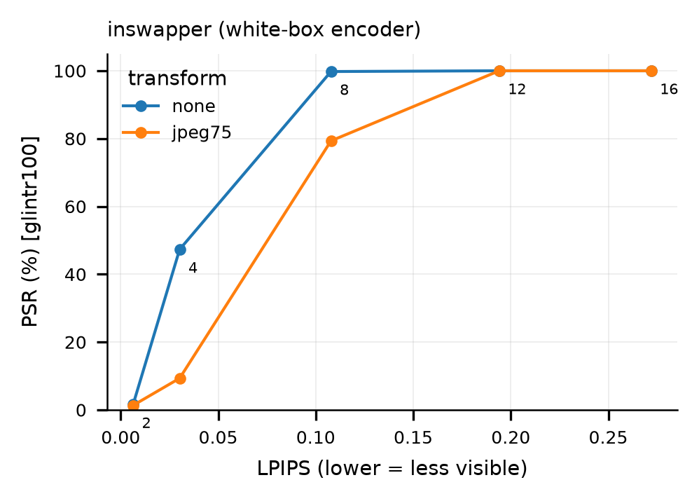

*Figure 6. PSR versus LPIPS trade-off, inswapper.*

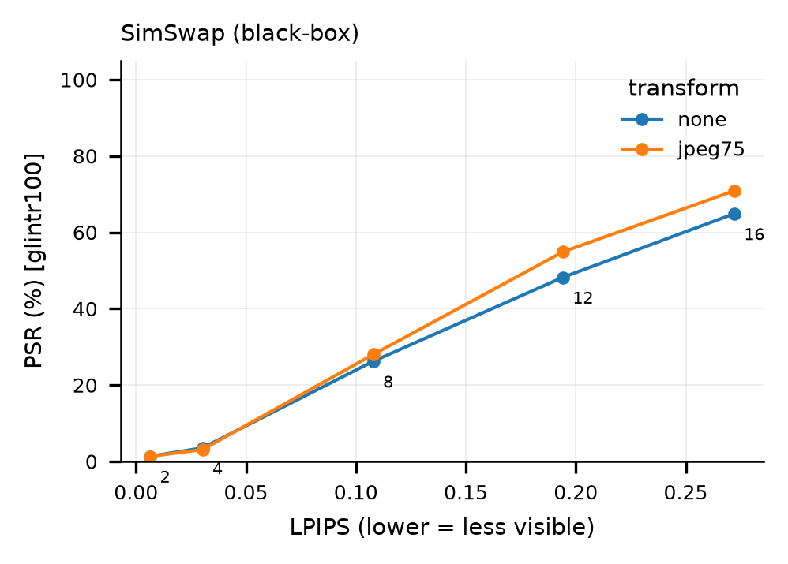

*Figure 7. PSR versus LPIPS trade-off, SimSwap.*

At ε = 2/255 the cloak is ineffective: the cloaked embedding keeps a cosine of +0.651 to the clean one under w600k_r50. At ε = 4/255 the white-box case already reaches 47.3 %, but this does not survive JPEG 75 (9.3 %). ε = 8/255 is the smallest budget tested at which the white-box case is saturated. Black-box transfer grows steadily with ε (26.2 % → 48.2 % → 64.9 % from 8 to 16), but at a large perceptual cost (LPIPS 0.107 → 0.271, PSNR 33.74 → 28.35 dB). For comparison, EOT with the LPIPS term reaches 85.1 % on SimSwap at ε = 8/255 and LPIPS 0.020, a better trade-off than any budget of the plain ensemble attack, including ε = 16/255 (64.9 % at LPIPS 0.271).

### 6.5 Number of PGD steps

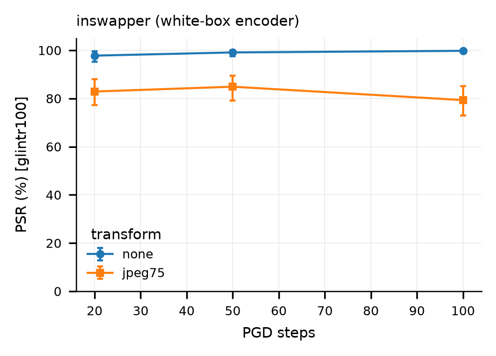

*Figure 8. Effect of the number of PGD steps, inswapper (pgd_ens, ε = 8/255, no EOT).*

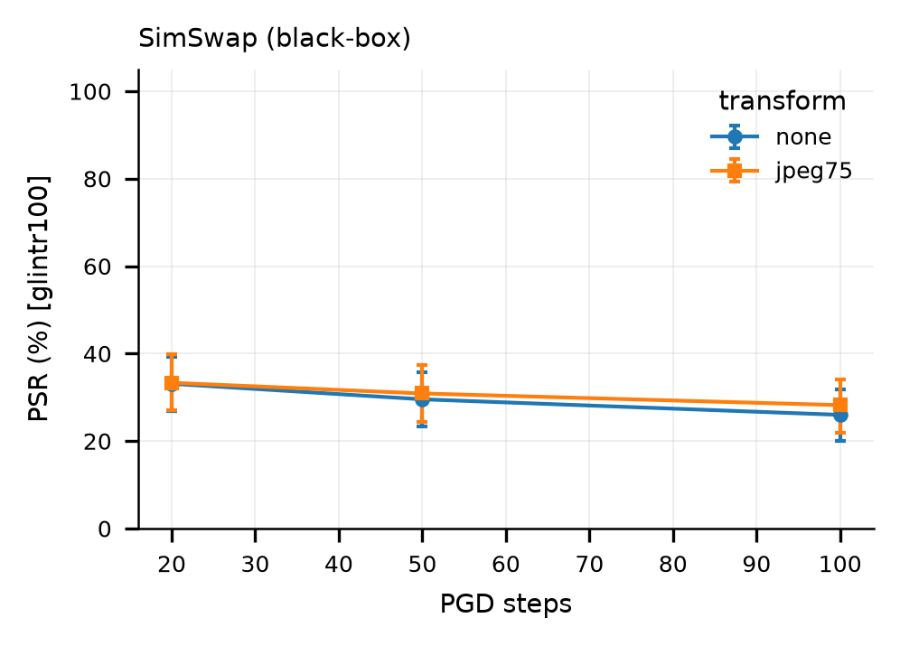

*Figure 9. Effect of the number of PGD steps, SimSwap (pgd_ens, ε = 8/255, no EOT).*

**Table 5. Steps ablation for pgd_ens (ε = 8/255, no EOT), PSR % [95 % CI].**

| Steps | Cloak time (s) | Cosine to clean (w600k_r50) | inswapper, none | inswapper, JPEG 75 | SimSwap, none | SimSwap, JPEG 75 |
|---|---|---|---|---|---|---|
| 20 | 1.2 | −0.286 | 97.8 [95.3, 99.6] | 82.9 [77.3, 88.0] | 33.1 [26.9, 39.3] | 33.3 [27.1, 39.8] |
| 50 | 2.7 | −0.522 | 99.1 [97.6, 100.0] | 84.9 [79.1, 89.6] | 29.6 [23.3, 35.8] | 30.9 [24.4, 37.3] |
| 100 | 5.2 | −0.585 | 99.8 [99.3, 100.0] | 79.3 [72.9, 85.1] | 26.0 [20.0, 31.8] | 28.2 [22.0, 34.0] |

More steps make the attack stronger on the models it optimises (the cosine to the clean w600k_r50 embedding falls from −0.286 to −0.585) and slightly improve white-box PSR (97.8 % → 99.8 %). On SimSwap, however, PSR *decreases* with more steps: 33.1 % → 29.6 % → 26.0 % without post-processing and 33.3 % → 30.9 % → 28.2 % with JPEG 75. This is a weak, non-significant downward trend: even the 20- and 100-step intervals overlap (33.1 [26.9, 39.3] vs 26.0 [20.0, 31.8]), and the 'none' and JPEG 75 conditions use the same cloaks, so they are not independent replications. It is consistent with the attack overfitting to the attack models, with additional iterations specialising the perturbation to features of w600k_r50 and FaceNet that do not carry over to SimSwap's identity network, but it does not establish it.

### 6.6 Identity-similarity distributions

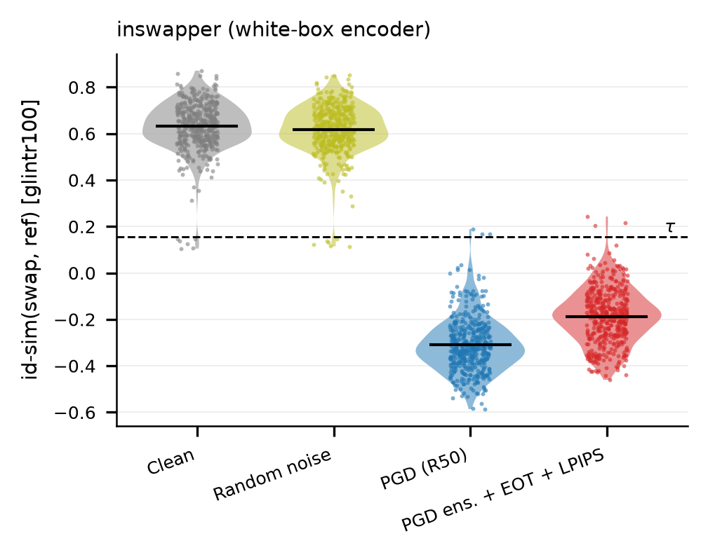

*Figure 10. Distribution of id-sim (glintr100) per swap, inswapper; dashed line: τ.*

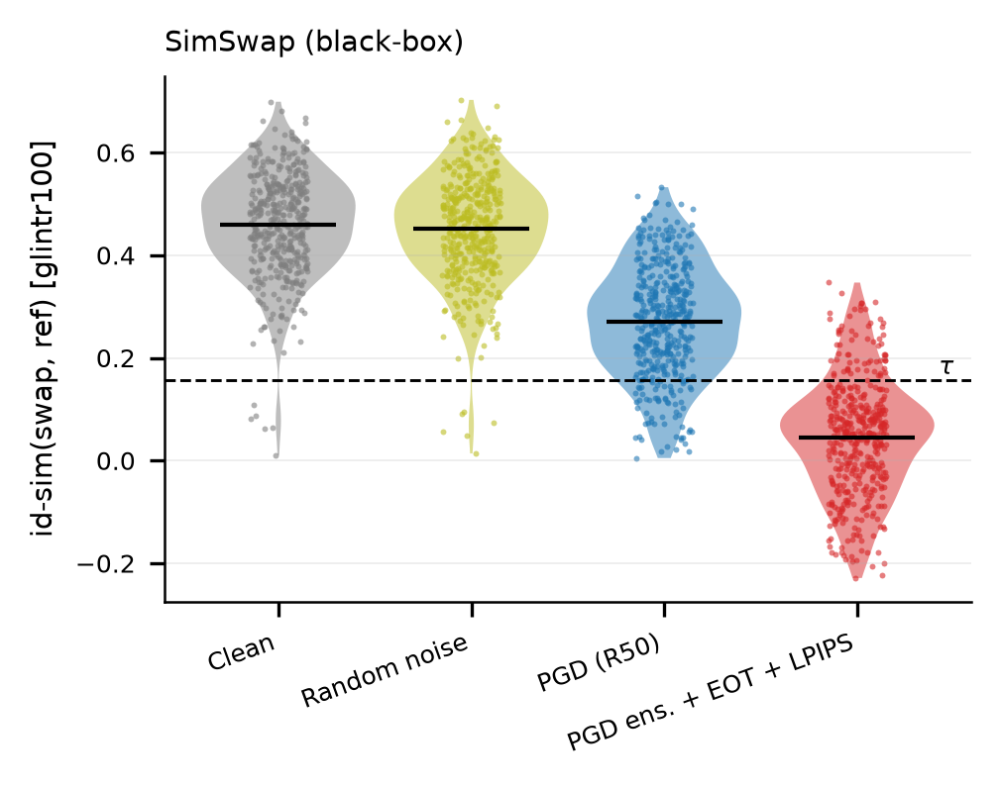

*Figure 11. Distribution of id-sim (glintr100) per swap, SimSwap; dashed line: τ.*

The distributions show that the PSR figures are not driven by a few borderline cases. On inswapper, clean swaps have a mean id-sim of +0.631, while the cloaked swaps have means between −0.310 and −0.069 depending on the attack, below τ = 0.1564. On SimSwap, clean swaps have a mean of +0.460; pgd_r50 shifts the distribution down (mean +0.271), but most swaps stay above τ, whereas EOT + LPIPS moves the bulk below τ (mean +0.045), leaving a tail above it that corresponds to the 14.9 % of swaps that remain unprotected.

### 6.7 Detector-suppression term

The detector term was intended to make the attacker's face detector fail. It did not. After cloaking with pgd_ens_det the face was still detected in 100 % of images, and the mean SCRFD confidence fell only from 0.834 (pgd_ens) to 0.809. No swap failed because of a missed detection (detection-failure rate 0.0 for every attack). PSR is essentially unchanged relative to pgd_ens (99.1 % vs 99.8 % on inswapper; 26.0 % vs 26.0 % on SimSwap), robustness is similar or slightly worse (e.g., JPEG 50 on inswapper: 38.0 % vs 39.6 %), and image quality is worse (LPIPS 0.170 vs 0.107; PSNR 33.20 vs 33.74 dB). Within an 8/255 budget, this loss could not push the detector's confidence on a clear face below its acceptance threshold, and spending part of the budget on it bought nothing.

---

## 7. Discussion

**EOT drives both robustness and black-box transfer.** EOT was introduced for robustness, and it delivers that: inswapper PSR under JPEG 50 rises from 39.6 % (pgd_ens) to 98.7 % (pgd_ens_eot). Its larger effect, however, is on transfer: SimSwap PSR rises from 26.0 % to 85.1 % with no post-processing at all. A plausible explanation, which we have not tested directly, is that averaging over resizing, blur, compression and landmark jitter suppresses fine perturbation patterns that are specific to w600k_r50 and FaceNet, leaving coarser changes that affect identity features shared across recognisers. Consistent with this, the EOT cloak moves the attack model's embedding *less* than plain PGD (cosine to the clean w600k_r50 embedding −0.305 vs −0.585 for pgd_ens) yet transfers far better. This suggests that driving the white-box loss as low as possible may not be the right goal; the steps ablation (Section 6.5) points the same way, though only weakly. One confound: in EOT runs the returned iterate is selected by its mean loss over 8 fixed EOT samples, whereas in non-EOT runs it is selected by the clean loss (Section 4.6). The jump from 26.0 % to 85.1 % therefore reflects EOT gradients and EOT-based iterate selection together; we did not separate the two.

**The LPIPS term causes no measurable PSR loss.** pgd_ens_eot_lpips matches pgd_ens_eot in PSR on both swappers (99.3 % vs 99.6 % on inswapper, confidence intervals overlapping; 85.1 % vs 85.1 % on SimSwap) and in robustness (Table 2), while LPIPS falls from 0.094 to 0.020. PSNR and SSIM hardly change (33.61 vs 33.59 dB; 0.851 vs 0.855), because the L∞ budget and overall perturbation energy are similar; what changes is the spatial structure of the perturbation. One caveat: LPIPS is both the optimised term and the reported metric, so part of this gain is by construction. We did not run a human perceptual study.

**Decoy targeting did not help.** Adding a Fawkes-style decoy term lowered PSR on inswapper without post-processing (96.7 % [93.6, 99.1] vs 99.8 % [99.3, 100.0]), the only clear difference. On SimSwap (22.7 % vs 26.0 %) and under JPEG 50 on inswapper (29.3 % vs 39.6 %) the point estimates are also lower, but the confidence intervals overlap, so there is no detectable difference there. The decoy term competes with the untargeted term for the same budget, and the cloaked embedding ends up less far from the clean one (cosine −0.354 vs −0.585). For removing an identity, pushing *away* from the person was at least as effective as also pulling *towards* a specific other person.

**What the judge score means, and what it does not.** PSR measures whether a face recogniser still matches the swap to the person; it does not measure whether a human would. inswapper works at 128 × 128 pixels and transfers only the *inner-face* identity carried by the embedding; skin tone, hair, face shape and lighting come from the target. On a team member's own low-light, head-tilted selfie, the judge declared the cloaked swap protected (the uncloaked swap scored well above τ, the cloaked one about 0), but to human viewers the inswapper output looked mostly like the target even without a cloak. The cloak worked as measured, but the demonstration was unconvincing because the unprotected deepfake was already weak. For this reason the live demo offers one-click example victims: public-domain NASA astronaut portraits that give clear, convincing uncloaked swaps. Their recorded identity scores (uncloaked swap → cloaked swap) are: Ellen Ochoa onto Kim, 0.753 → −0.388; Raja Chari onto Jemison, 0.851 → −0.372; Anil Menon onto Kim, 0.841 → −0.226; Kalpana Chawla onto Jemison, 0.845 → 0.006. In live browser runs we observed Chari 0.848 → −0.287 and Chawla 0.85 → about 0.05. The Chawla example is protected (below τ = 0.1564) but with a smaller margin, in line with the spread seen in Section 6.6.

**Sanity checks.** Several results act as internal controls.

- Clean and random-noise PSR are equal (1.3 % on both swappers) and stay at 0.9–2.2 % under every transform, so neither a random perturbation of the same size nor the post-processing alone produces protection.
- The L∞ norm of every delivered cloak equals ε exactly (8/255 in the main experiment; 2, 4, 12 and 16/255 in the ε ablation), confirming that the budget is enforced after quantisation.
- On inswapper, the white-box judge w600k_r50 reports a PSR equal to or higher than the held-out glintr100 for every PGD attack, the expected ordering when the cloak was optimised against w600k_r50. On SimSwap the two judges differ by at most 2.0 points in either direction, within the confidence intervals.
- The configuration pgd_ens (ε = 8/255, 100 steps) appears in the main experiment and in both ablations and gives consistent results (SimSwap: 26.0 %, 26.2 % and 26.0 %; inswapper with JPEG 75: 79.3 % in all three). We did not investigate the source of the small residual differences.

---

## 8. Limitations

1. **Strong smoothing.** Gaussian blur with σ = 2 and bilateral filtering reduce the SimSwap PSR of the EOT cloaks to 46.4–48.7 % and the inswapper PSR to 71.8–88.0 %. An attacker who smooths the photo before swapping, at some cost to the swap's sharpness, removes much of the protection on the black-box swapper.
2. **Plain PGD is brittle.** Without EOT, JPEG 50 or blur σ = 2 largely removes the cloak (pgd_r50 on inswapper: 50.2 % and 1.1 %). A deployed cloak must use EOT or an equivalent.
3. **No adaptive attacker or learned purification.** We did not evaluate an attacker who knows the method and adapts to it [23], diffusion-based purification such as DiffPure [24], or denoisers trained to remove cloaks. These are the most likely ways to defeat the defence; our numbers should be read as an upper bound on protection against such attackers.
4. **Data.** LFW images are low-resolution photos of celebrities with limited variation in pose and lighting; results on high-resolution phone photos or video frames may differ.
5. **Only the source path.** We protect the identity donor. Protecting the target image (the one being edited) is a different problem that we did not address.
6. **Swapper coverage.** Black-box transfer was tested on one swapper (SimSwap). Swappers that do not take a recogniser embedding as their identity input may not be affected at all.
7. **Single seed.** All experiments use seed 0. Confidence intervals capture variation across identities, not across random restarts of the attack.
8. **Judge independence.** w600k_mbf shares training data with the attack model, so only glintr100 is a held-out judge in the strict sense (never used in the attack); it is still an InsightFace ArcFace-family model, so it is not independent of the model family we attack.
9. **Latency.** The recommended configuration takes 8.4 s per image on a T4 GPU; on a laptop CPU, a demo run with reduced settings took about 55 s. This is acceptable for a one-off upload but not for real-time use.

---

## 9. Ethical Considerations

This is a defensive project: its purpose is to make a person's photos less useful as raw material for non-consensual deepfakes. Building and evaluating such a defence necessarily involves running face-swap models, and we took the following precautions.

- **Model licences.** The third-party weights (InsightFace inswapper_128, buffalo_l and antelopev2, and SimSwap) are licensed for non-commercial research only. They are downloaded at run time and never redistributed in the repository.
- **Data.** No face dataset is committed to the repository. LFW is downloaded at run time, and experiment outputs that contain real faces and swaps are kept private.
- **Demo safeguards.** The live demo swaps only onto fixed, public-domain NASA portraits (Duke, Godwin, Jemison, Kim, Moghbeli, Rubio, Collins); users cannot upload their own targets. Every synthetic image is watermarked "SYNTHETIC · face-cloak demo". Use requires a consent tick and a passcode (`X-Demo-Key` header). Requests are rate-limited (5 jobs per hour per IP address, 40 jobs per hour in total). Uploads are held in memory only and dropped after at most 10 minutes.
- **Dual use.** The cloak itself cannot be used to create a deepfake. Its main risk is a false sense of security, so we state the limitations of Section 8 prominently, including on the demo website.

---

## 10. Conclusion and Future Work

One-shot face swappers inherit the weaknesses of the face recognisers they use as identity encoders. For inswapper_128, whose identity channel is a public ArcFace model, an ε = 8/255 PGD cloak removes the source identity, as judged by a held-out recogniser, from 96.7–99.8 % of swaps across all PGD variants (99.3 % for PGD-r50, 99.8 % for the ensemble, 99.6 % with EOT and 99.3 % with EOT + LPIPS). With EOT the protection survives JPEG compression down to quality 50 and resizing to half size, and it transfers to the black-box SimSwap model in 85.1 % of cases; adding an LPIPS penalty causes no measurable PSR loss and reduces LPIPS to 0.020. Decoy targeting, a detector-suppression term and more PGD steps did not help (for the last, the trend on SimSwap is weak and not significant). The cloak remains vulnerable to strong smoothing and has not been tested against adaptive attackers or diffusion purification.

Future work: (i) evaluate against diffusion purification and adaptive attackers; (ii) add stronger smoothing (blur up to σ = 2, bilateral filtering) to the EOT distribution and measure the quality cost; (iii) enlarge the ensemble to improve black-box transfer; (iv) test further swappers and high-resolution or video inputs; (v) run a human perceptual study of both cloak visibility and swap identity; (vi) repeat the experiments with several seeds.

---

## Appendix A. Reproducibility

**Repository layout** (https://github.com/J4KE-B/face-cloak):

```
facecloak/   core package: models, differentiable alignment, PGD cloak, swappers, metrics, experiment runner
scripts/     data preparation, calibration, experiments, merging, figures/tables, web export
configs/     experiment configs: smoke, main, ablation_eps, ablation_steps
server/      live-demo back end (FastAPI) and laptop tunnel script
web/         live-demo website (Next.js), deployed on Vercel
notebooks/   kaggle_run.ipynb (full experiments), kaggle_demo_server.ipynb (GPU demo back end)
tests/       pytest suite
report/      LaTeX sources (in-progress draft)   docs/   this report (canonical), presentation brief, website guide
```

**Running the experiments on Kaggle.** Import `notebooks/kaggle_run.ipynb` into a Kaggle notebook (GPU T4, Internet on). Set `SHARD = "0/2"` in one session and `SHARD = "1/2"` in another, and set `REPO_REF` to the pinned commit (e32b9b6 for the reported results). Each session writes a results zip. For each config the notebook runs:

```bash
python scripts/run_experiments.py --config configs/main.yaml --shard 0/2
python scripts/run_experiments.py --config configs/ablation_eps.yaml --shard 0/2
python scripts/run_experiments.py --config configs/ablation_steps.yaml --shard 0/2
```

**Merging, figures and web export** (locally, after downloading both zips):

```bash
python scripts/merge_results.py results_shard0of2.zip results_shard1of2.zip --out results/raw --cache results/cache/cloaked
python scripts/make_figures.py          # results/raw -> results/figs (PNG/PDF) and results/tables (CSV/TeX)
python scripts/export_web_results.py    # figures and summary.json -> web/public/results
```

The LaTeX sources in `report/` are an in-progress draft; this `docs/REPORT.md` is the canonical report. `KAGGLE_RUN.md` gives a step-by-step guide. The live demo runs at https://face-cloak.vercel.app; `docs/WEBSITE_GUIDE.md` explains how to start its back end.

---

## Appendix B. Full robustness tables

PSR (%) with 95 % cluster-bootstrap CIs, judge glintr100, n = 450 per cell.

**Table B1. inswapper (white-box encoder).**

| Attack | none | JPEG 90 | JPEG 75 | JPEG 50 | resize 0.75 | resize 0.5 | blur σ=1 | blur σ=2 | median 3 | bilateral |
|---|---|---|---|---|---|---|---|---|---|---|
| clean | 1.3 [0.0, 3.3] | 1.3 [0.0, 3.3] | 1.3 [0.0, 3.3] | 1.3 [0.0, 3.3] | 1.3 [0.0, 3.3] | 1.3 [0.0, 3.3] | 1.3 [0.0, 3.3] | 0.9 [0.0, 2.2] | 1.1 [0.0, 2.9] | 1.1 [0.0, 2.9] |
| noise | 1.3 [0.0, 3.3] | 1.3 [0.0, 3.3] | 1.1 [0.0, 2.9] | 1.3 [0.0, 3.3] | 1.3 [0.0, 3.3] | 1.3 [0.0, 3.3] | 1.3 [0.0, 3.3] | 1.1 [0.0, 2.9] | 1.3 [0.0, 3.3] | 1.1 [0.0, 2.9] |
| pgd_r50 | 99.3 [98.0, 100.0] | 99.3 [98.0, 100.0] | 93.3 [89.6, 96.7] | 50.2 [42.7, 57.3] | 97.3 [94.7, 99.3] | 75.6 [68.9, 82.0] | 40.4 [33.1, 47.8] | 1.1 [0.0, 2.7] | 95.8 [92.9, 98.2] | 3.1 [1.1, 5.8] |
| pgd_ens | 99.8 [99.3, 100.0] | 96.2 [93.3, 98.4] | 79.3 [72.7, 85.3] | 39.6 [32.2, 46.9] | 92.7 [88.4, 96.2] | 54.7 [47.1, 61.8] | 29.8 [22.9, 36.2] | 1.1 [0.0, 2.9] | 83.6 [77.3, 89.1] | 3.6 [1.1, 6.2] |
| pgd_ens_targeted | 96.7 [93.6, 99.1] | 88.0 [83.1, 92.4] | 64.9 [57.8, 71.6] | 29.3 [22.9, 35.8] | 84.9 [79.8, 89.8] | 47.1 [39.6, 54.2] | 20.7 [14.9, 26.4] | 0.7 [0.0, 2.0] | 72.4 [65.6, 78.7] | 1.3 [0.0, 3.3] |
| pgd_ens_eot | 99.6 [98.7, 100.0] | 99.6 [98.7, 100.0] | 99.1 [97.3, 100.0] | 98.7 [96.7, 100.0] | 99.6 [98.7, 100.0] | 99.3 [98.0, 100.0] | 99.3 [98.0, 100.0] | 72.2 [65.3, 78.7] | 99.3 [98.0, 100.0] | 88.0 [83.1, 92.4] |
| pgd_ens_eot_lpips | 99.3 [98.0, 100.0] | 99.3 [98.0, 100.0] | 99.1 [97.3, 100.0] | 98.7 [96.7, 100.0] | 99.3 [98.0, 100.0] | 99.3 [98.0, 100.0] | 99.3 [98.0, 100.0] | 71.8 [64.9, 78.0] | 99.3 [98.0, 100.0] | 87.3 [82.2, 92.0] |
| pgd_ens_det | 99.1 [97.6, 100.0] | 93.6 [90.0, 96.7] | 78.0 [71.3, 84.0] | 38.0 [30.4, 45.3] | 89.6 [84.4, 94.0] | 54.7 [47.3, 61.8] | 29.3 [22.4, 36.0] | 0.9 [0.0, 2.4] | 83.6 [77.3, 89.1] | 3.8 [1.3, 6.4] |

**Table B2. SimSwap (black-box).**

| Attack | none | JPEG 90 | JPEG 75 | JPEG 50 | resize 0.75 | resize 0.5 | blur σ=1 | blur σ=2 | median 3 | bilateral |
|---|---|---|---|---|---|---|---|---|---|---|
| clean | 1.3 [0.0, 3.3] | 1.3 [0.0, 3.3] | 1.3 [0.0, 3.3] | 1.3 [0.0, 3.3] | 1.3 [0.0, 3.3] | 1.3 [0.0, 3.3] | 1.3 [0.0, 3.3] | 2.2 [0.2, 4.9] | 1.3 [0.0, 3.3] | 1.6 [0.0, 3.6] |
| noise | 1.3 [0.0, 3.3] | 1.3 [0.0, 3.3] | 1.3 [0.0, 3.3] | 1.3 [0.0, 3.3] | 1.3 [0.0, 3.3] | 1.3 [0.0, 3.3] | 1.3 [0.0, 3.3] | 2.2 [0.2, 4.9] | 1.3 [0.0, 3.3] | 1.6 [0.0, 3.6] |
| pgd_r50 | 14.2 [9.8, 18.7] | 16.2 [11.3, 21.1] | 15.1 [10.4, 19.8] | 13.6 [9.1, 18.2] | 11.1 [7.1, 15.3] | 8.9 [5.3, 12.9] | 5.1 [2.4, 8.2] | 5.6 [2.7, 8.7] | 10.4 [6.7, 14.4] | 4.9 [2.0, 8.0] |
| pgd_ens | 26.0 [19.8, 32.0] | 28.4 [22.0, 34.4] | 28.2 [22.0, 34.0] | 24.2 [18.2, 29.8] | 20.2 [15.1, 25.6] | 13.1 [8.9, 17.1] | 10.4 [6.9, 14.2] | 8.7 [4.9, 12.9] | 22.7 [17.1, 28.2] | 6.0 [3.1, 9.1] |
| pgd_ens_targeted | 22.7 [17.3, 28.4] | 24.4 [18.7, 30.2] | 22.4 [16.7, 28.2] | 19.8 [14.4, 25.3] | 16.2 [11.1, 21.3] | 12.0 [7.8, 16.2] | 8.4 [4.9, 12.0] | 5.6 [2.7, 8.7] | 17.6 [12.2, 22.7] | 4.2 [1.6, 7.1] |
| pgd_ens_eot | 85.1 [79.6, 90.0] | 84.4 [78.9, 89.3] | 84.2 [78.7, 89.1] | 83.6 [78.0, 88.9] | 85.1 [79.6, 90.0] | 82.4 [76.7, 87.6] | 77.6 [71.6, 83.1] | 48.4 [41.3, 54.9] | 83.8 [78.0, 88.7] | 46.7 [40.0, 53.3] |
| pgd_ens_eot_lpips | 85.1 [79.6, 90.0] | 84.7 [79.1, 89.6] | 83.6 [78.0, 88.4] | 81.6 [75.3, 86.9] | 84.4 [78.4, 89.6] | 83.1 [77.3, 88.2] | 77.8 [71.6, 83.3] | 48.7 [41.6, 55.1] | 82.9 [76.9, 88.2] | 46.4 [39.6, 53.1] |
| pgd_ens_det | 26.0 [20.0, 32.2] | 28.0 [21.8, 33.8] | 26.9 [20.7, 32.9] | 23.3 [18.0, 28.4] | 21.6 [16.0, 26.9] | 16.2 [11.6, 20.9] | 9.8 [6.2, 13.6] | 8.4 [4.7, 12.4] | 23.6 [18.0, 29.1] | 6.4 [3.3, 9.8] |

---

## References

[1] R. Tolosana, R. Vera-Rodriguez, J. Fierrez, A. Morales, and J. Ortega-Garcia, "Deepfakes and beyond: A survey of face manipulation and fake detection," *Information Fusion*, vol. 64, pp. 131–148, 2020, doi: 10.1016/j.inffus.2020.06.014.

[2] L. Li, J. Bao, H. Yang, D. Chen, and F. Wen, "FaceShifter: Towards high fidelity and occlusion aware face swapping," *arXiv preprint arXiv:1912.13457*, 2019.

[3] R. Chen, X. Chen, B. Ni, and Y. Ge, "SimSwap: An efficient framework for high fidelity face swapping," in *Proc. 28th ACM Int. Conf. Multimedia*, 2020, pp. 2003–2011, doi: 10.1145/3394171.3413630.

[4] J. Guo and J. Deng, "InsightFace: 2D and 3D face analysis project," GitHub repository, 2017. [Online]. Available: https://github.com/deepinsight/insightface (accessed Oct. 2026).

[5] J. Deng, J. Guo, N. Xue, and S. Zafeiriou, "ArcFace: Additive angular margin loss for deep face recognition," in *Proc. IEEE/CVF Conf. Comput. Vis. Pattern Recognit. (CVPR)*, 2019, pp. 4685–4694, doi: 10.1109/CVPR.2019.00482.

[6] A. Madry, A. Makelov, L. Schmidt, D. Tsipras, and A. Vladu, "Towards deep learning models resistant to adversarial attacks," in *Proc. Int. Conf. Learn. Represent. (ICLR)*, 2018.

[7] A. Athalye, L. Engstrom, A. Ilyas, and K. Kwok, "Synthesizing robust adversarial examples," in *Proc. 35th Int. Conf. Mach. Learn. (ICML)*, ser. Proc. Mach. Learn. Res., vol. 80, 2018, pp. 284–293.

[8] R. Zhang, P. Isola, A. A. Efros, E. Shechtman, and O. Wang, "The unreasonable effectiveness of deep features as a perceptual metric," in *Proc. IEEE/CVF Conf. Comput. Vis. Pattern Recognit. (CVPR)*, 2018, pp. 586–595, doi: 10.1109/CVPR.2018.00068.

[9] G. B. Huang, M. Ramesh, T. Berg, and E. Learned-Miller, "Labeled Faces in the Wild: A database for studying face recognition in unconstrained environments," Univ. Massachusetts, Amherst, Tech. Rep. 07-49, Oct. 2007.

[10] A. Rössler, D. Cozzolino, L. Verdoliva, C. Riess, J. Thies, and M. Nießner, "FaceForensics++: Learning to detect manipulated facial images," in *Proc. IEEE/CVF Int. Conf. Comput. Vis. (ICCV)*, 2019, pp. 1–11, doi: 10.1109/ICCV.2019.00009.

[11] X. An, X. Zhu, Y. Gao, Y. Xiao, Y. Zhao, Z. Feng *et al.*, "Partial FC: Training 10 million identities on a single machine," in *Proc. IEEE/CVF Int. Conf. Comput. Vis. Workshops (ICCVW)*, 2021, pp. 1445–1449, doi: 10.1109/ICCVW54120.2021.00166.

[12] J. Guo, J. Deng, A. Lattas, and S. Zafeiriou, "Sample and computation redistribution for efficient face detection," in *Proc. Int. Conf. Learn. Represent. (ICLR)*, 2022.

[13] C. Szegedy, W. Zaremba, I. Sutskever, J. Bruna, D. Erhan, I. Goodfellow, and R. Fergus, "Intriguing properties of neural networks," in *Proc. Int. Conf. Learn. Represent. (ICLR)*, 2014.

[14] I. J. Goodfellow, J. Shlens, and C. Szegedy, "Explaining and harnessing adversarial examples," in *Proc. Int. Conf. Learn. Represent. (ICLR)*, 2015.

[15] N. Ruiz, S. A. Bargal, and S. Sclaroff, "Disrupting deepfakes: Adversarial attacks against conditional image translation networks and facial manipulation systems," in *Computer Vision – ECCV 2020 Workshops*, ser. Lecture Notes in Computer Science, vol. 12538. Springer, 2020, pp. 236–251, doi: 10.1007/978-3-030-66823-5_14.

[16] S. Aneja, L. Markhasin, and M. Nießner, "TAFIM: Targeted adversarial attacks against facial image manipulations," in *Computer Vision – ECCV 2022*, ser. Lecture Notes in Computer Science. Springer, 2022, pp. 58–75, doi: 10.1007/978-3-031-19781-9_4.

[17] H. Huang, Y. Wang, Z. Chen, Y. Zhang, Y. Li, Z. Tang, W. Chu, J. Chen, W. Lin, and K.-K. Ma, "CMUA-Watermark: A cross-model universal adversarial watermark for combating deepfakes," in *Proc. AAAI Conf. Artif. Intell.*, vol. 36, no. 1, 2022, pp. 989–997, doi: 10.1609/aaai.v36i1.19982.

[18] R. Wang, Z. Huang, Z. Chen, L. Liu, J. Chen, and L. Wang, "Anti-Forgery: Towards a stealthy and robust DeepFake disruption attack via adversarial perceptual-aware perturbations," in *Proc. 31st Int. Joint Conf. Artif. Intell. (IJCAI)*, 2022, pp. 761–767, doi: 10.24963/ijcai.2022/107.

[19] H. Salman, A. Khaddaj, G. Leclerc, A. Ilyas, and A. Madry, "Raising the cost of malicious AI-powered image editing," in *Proc. 40th Int. Conf. Mach. Learn. (ICML)*, ser. Proc. Mach. Learn. Res., vol. 202, 2023, pp. 29894–29918.

[20] T. Van Le, H. Phung, T. H. Nguyen, Q. Dao, N. N. Tran, and A. Tran, "Anti-DreamBooth: Protecting users from personalized text-to-image synthesis," in *Proc. IEEE/CVF Int. Conf. Comput. Vis. (ICCV)*, 2023, pp. 2116–2127, doi: 10.1109/ICCV51070.2023.00202.

[21] S. Shan, E. Wenger, J. Zhang, H. Li, H. Zheng, and B. Y. Zhao, "Fawkes: Protecting privacy against unauthorized deep learning models," in *Proc. 29th USENIX Security Symp. (USENIX Security 20)*, 2020, pp. 1589–1604.

[22] V. Cherepanova, M. Goldblum, H. Foley, S. Duan, J. P. Dickerson, G. Taylor, and T. Goldstein, "LowKey: Leveraging adversarial attacks to protect social media users from facial recognition," in *Proc. Int. Conf. Learn. Represent. (ICLR)*, 2021.

[23] A. Athalye, N. Carlini, and D. Wagner, "Obfuscated gradients give a false sense of security: Circumventing defenses to adversarial examples," in *Proc. 35th Int. Conf. Mach. Learn. (ICML)*, ser. Proc. Mach. Learn. Res., vol. 80, 2018, pp. 274–283.

[24] W. Nie, B. Guo, Y. Huang, C. Xiao, A. Vahdat, and A. Anandkumar, "Diffusion models for adversarial purification," in *Proc. 39th Int. Conf. Mach. Learn. (ICML)*, ser. Proc. Mach. Learn. Res., vol. 162, 2022, pp. 16805–16827.

[25] F. Schroff, D. Kalenichenko, and J. Philbin, "FaceNet: A unified embedding for face recognition and clustering," in *Proc. IEEE Conf. Comput. Vis. Pattern Recognit. (CVPR)*, 2015, pp. 815–823, doi: 10.1109/CVPR.2015.7298682.

[26] Q. Cao, L. Shen, W. Xie, O. M. Parkhi, and A. Zisserman, "VGGFace2: A dataset for recognising faces across pose and age," in *Proc. 13th IEEE Int. Conf. Autom. Face Gesture Recognit. (FG 2018)*, 2018, pp. 67–74, doi: 10.1109/FG.2018.00020.
